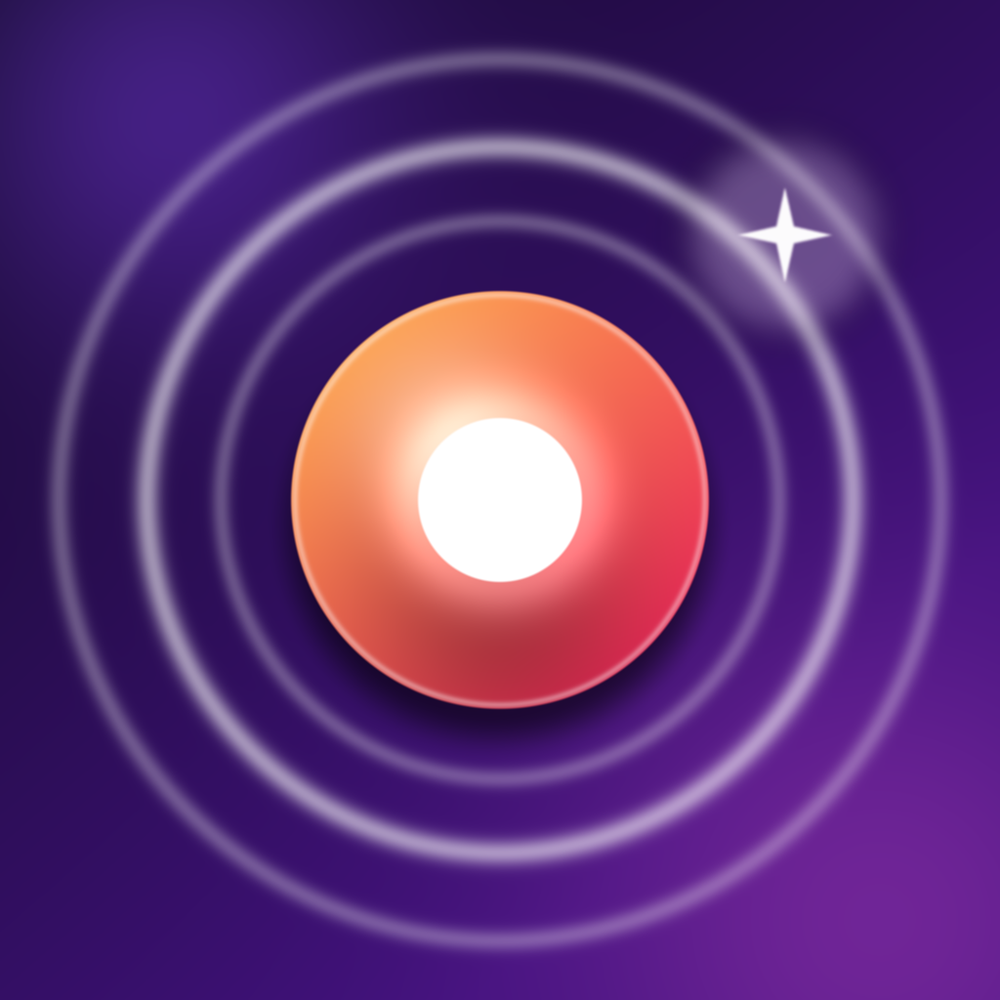

# Тап-Кликер (TapClicker)

Простая, но полностью рабочая игра-кликер для iPhone на SwiftUI.
Тапаешь по кругу — получаешь очки, покупаешь улучшения, ставишь рекорды.



## Что внутри

- **Тап** — большая кнопка с пружинной анимацией, тактильным откликом (haptic) и всплывающими `+N`.
- **Криты** — шанс крита до 50 %, урон ×5, вспышка золотым «КРИТ +N».
- **4 улучшения** — сила тапа, автоклик (доход в секунду), шанс крита, общий множитель. Цена растёт по геометрической прогрессии.
- **Сохранение** — прогресс пишется в `UserDefaults` каждые 10 секунд и при сворачивании приложения.
- **Оффлайн-доход** — пока игра закрыта, автоклик копит до 8 часов; при запуске показывается награда.
- **Сброс прогресса** — кнопка в правом верхнем углу с подтверждением.
- Тёмная тема, вёрстка под портретную ориентацию, iOS 16+.

Никаких сторонних зависимостей, никакой сети — приложение полностью офлайновое.

## Структура

```
TapClicker/
├── project.yml                  # описание проекта для XcodeGen
├── Info.plist
├── Sources/
│   ├── App/TapClickerApp.swift  # точка входа
│   ├── Game/Format.swift        # форматирование чисел (1.2K, 3.4M)
│   ├── Game/Upgrade.swift       # каталог улучшений, цены
│   ├── Game/GameState.swift     # логика, сохранение, оффлайн-доход
│   ├── Support/Haptics.swift    # тактильный отклик
│   └── Views/                   # ContentView, ShopView, FloatingNumber
├── Resources/Assets.xcassets    # иконка приложения
├── scripts/make_icon.py         # перегенерация иконки
└── .github/workflows/build-ipa.yml
```

---

## Вариант A. Есть Mac (быстрее всего)

```bash
brew install xcodegen
cd TapClicker
xcodegen generate
open TapClicker.xcodeproj
```

В Xcode: выбери таргет **TapClicker** → вкладка *Signing & Capabilities* → укажи свою **Team** и при необходимости поменяй **Bundle Identifier** → подключи iPhone → **Run** (⌘R).

Xcode сам создаст сертификат и профиль и установит приложение. `.ipa` для распространения: *Product → Archive → Distribute App*.

> Без Mac проект можно открыть в облачном Mac (MacinCloud и подобные, ~$1/час) — хватит 15 минут.

## Вариант B. Windows: сборка в облаке + подпись сертификатом

Схема: исходники собираются на macOS-раннере GitHub, оттуда вы получаете **неподписанный** `.ipa`, подписываете его своим сертификатом на Windows и ставите на телефон.

### Шаг 1. Залить проект в GitHub

Создай пустой репозиторий на github.com, затем в папке `TapClicker`:

```bash
git init
git add .
git commit -m "TapClicker: clicker game"
git branch -M main
git remote add origin https://github.com/<твой-логин>/tapclicker.git
git push -u origin main
```

Файлы `.p12` и `.mobileprovision` **не коммить** — они уже в `.gitignore`.

### Шаг 2. Запустить сборку

На GitHub: вкладка **Actions** → workflow **Build IPA** → **Run workflow**.
Через ~3–5 минут открой завершённый запуск → внизу **Artifacts** → скачай `TapClicker-unsigned-ipa`.

Внутри zip лежит `TapClicker-unsigned.ipa`. Это просто архив с папкой `Payload/TapClicker.app` без подписи.

Если хочешь свой Bundle ID, впиши его в поле `bundle_id` при запуске workflow (он должен совпадать с профилем подписи или быть подстановочным, например `com.твоёимя.*`).

### Шаг 3. Подписать и установить (Windows)

Нужно:

1. **Sideloadly** — [sideloadly.io](https://sideloadly.io) (Windows-версия, ставится вместе с iTunes-драйверами).
2. Твой **`.p12`** (сертификат) + пароль и **`.mobileprovision`** (профиль), в котором прописан UDID твоего iPhone.
   Если профиля ещё нет: [developer.apple.com](https://developer.apple.com/account/resources/profiles/list) → *Profiles → + → iOS App Development* → выбери сертификат и **своё устройство** (устройство сначала добавляется в *Devices* по UDID).
3. UDID телефона: виден в Sideloadly при подключении, либо в 3uTools, либо в iTunes (клик по номеру телефона).

Порядок:

1. Подключи iPhone кабелем, нажми на нём **Доверять этому компьютеру**.
2. Открой Sideloadly, перетащи `TapClicker-unsigned.ipa` в окно.
3. В поле *Apple ID* можно ввести логин/пароль аккаунта (тогда Sideloadly сам сделает сертификат и профиль), **либо** нажать на иконку ключа и указать свои `.p12` + `.mobileprovision`.
4. **Start**. Через минуту приложение появится на телефоне.

Альтернатива без Sideloadly — подписать вручную через `zsign`:

```powershell
zsign -k cert.p12 -p <пароль> -m profile.mobileprovision -o TapClicker-signed.ipa TapClicker-unsigned.ipa
```

и установить, например, через `ideviceinstaller -i TapClicker-signed.ipa` (пакет libimobiledevice).

### Шаг 4. Первый запуск на iPhone

1. **Настройки → Конфиденциальность и безопасность → Режим разработчика** → включить (появится после первой попытки установки; телефон перезагрузится).
2. **Настройки → Основные → VPN и управление устройством → Разработчик: <твой Apple ID> → Доверять**.
3. Запускай игру.

Срок жизни подписи: **1 год** на платном аккаунте разработчика, **7 дней** на бесплатном Apple ID (потом просто переподписать тем же способом, прогресс сохранится, если не удалять приложение).

---

## Что легко поменять

| Что | Где |
|---|---|
| Название на экране | `Sources/Views/ContentView.swift`, `header` |
| Название под иконкой | `Info.plist` → `CFBundleDisplayName` |
| Bundle ID | `project.yml` → `PRODUCT_BUNDLE_IDENTIFIER` |
| Улучшения, цены, баланс | `Sources/Game/Upgrade.swift` |
| Скорость роста цен | поле `growth` у каждого улучшения |
| Крит (шанс/урон) | `Sources/Game/GameState.swift` → `critChance`, `critMultiplier` |
| Потолок оффлайн-дохода | `GameState.swift` → `offlineLimit` |
| Версия | `project.yml` → `MARKETING_VERSION`, `CURRENT_PROJECT_VERSION` |

## Пересобрать иконку

```bash
python scripts/make_icon.py   # нужен Pillow
```

Скрипт рисует PNG 1024×1024 в `Resources/Assets.xcassets/AppIcon.appiconset/`.

## Частые ошибки

- **`Unable to install ... provisioning profile doesn't include signing certificate`** — `.p12` и профиль не совпадают. Профиль должен быть выпущен для того же сертификата.
- **`... doesn't include the device`** — UDID телефона не добавлен в профиль. Добавь устройство в developer.apple.com и пересоздай профиль.
- **«Ненадёжный разработчик»** — не включён режим разработчика или не нажато «Доверять».
- **`xcodebuild` падает на CI** — открой лог шага *Archive*, чаще всего это опечатка в Swift-коде; проект собирается с `CODE_SIGNING_ALLOWED=NO`, так что сертификаты тут ни при чём.
- **Приложение открывается не на весь экран** — в `Info.plist` должен остаться `UILaunchScreen`.

## Лицензия

Делай что хочешь, только не выкладывай в App Store под чужим именем.
